# lmplot

**gnuplot as one static executable, scriptable from lmscript — zero runtime dependencies, embedded DejaVu fonts, and byte-identical PNG/SVG output.**

[](https://github.com/lmctl-ai/lmplot/actions/workflows/ci.yml)
[](https://github.com/lmctl-ai/lmplot/releases)
[](LICENSE)

| Exoplanet Doppler RV & O-C residuals | Landau 3D free-energy surface | Equity OHLC, Bollinger & drawdown |
| --- | --- | --- |
| 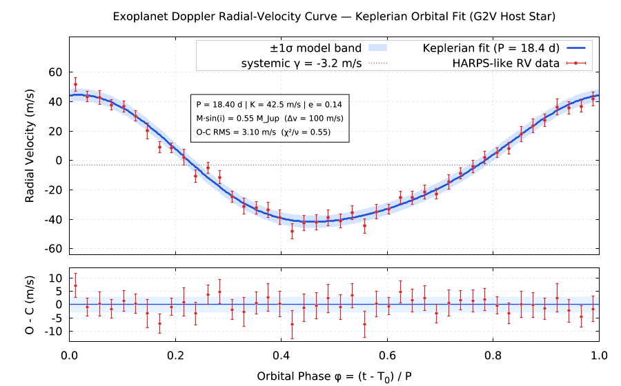 | 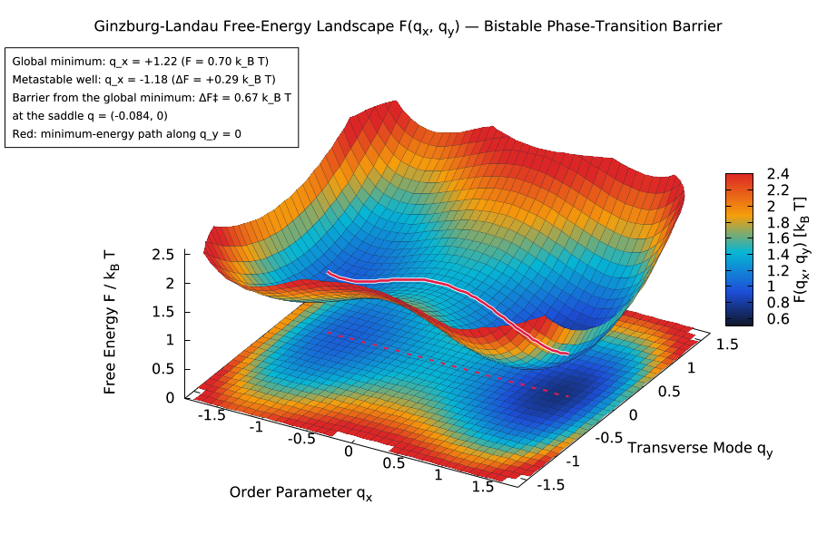 | 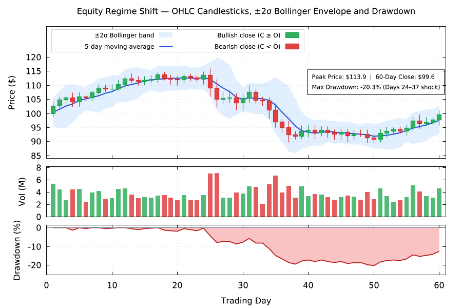 |
| Keplerian fit, mass & χ² in DSL<br>`lmctl autorun https://raw.githubusercontent.com/lmctl-ai/lmplot/main/examples/kepler_rv_fit.lms` | Bistable `pm3d` surface & transition path<br>`lmctl autorun https://raw.githubusercontent.com/lmctl-ai/lmplot/main/examples/potential_vortex_surface.lms` | Candlesticks, ±2σ band, volume & drawdown<br>`lmctl autorun https://raw.githubusercontent.com/lmctl-ai/lmplot/main/examples/quant_trading_dashboard.lms` |

| 3D CAD nozzle + supersonic flow (`lmcad` + `lmplot`) | SEIR schematic + ODE phase plane (`lmdraw` + `lmplot`) | Quantum wave-packet scattering (`ffmpeg` GIF) |
| --- | --- | --- |
| 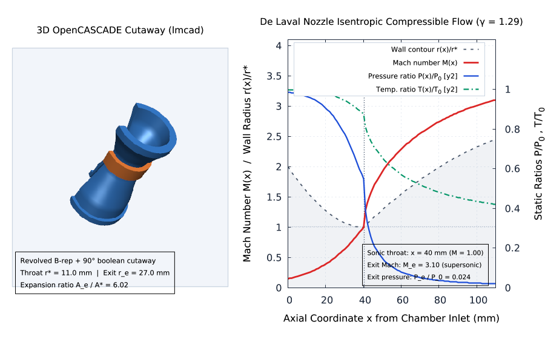 | 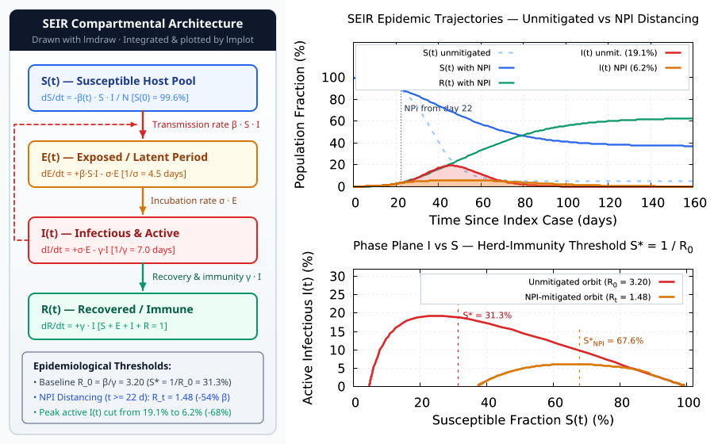 | 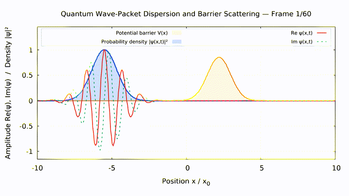 |
| OpenCASCADE cutaway + Mach/P/T curves<br>`lmctl autorun https://raw.githubusercontent.com/lmctl-ai/lmplot/main/examples/combo/nozzle_cad_plot.lms` | Retained 2D diagram + RK4 trajectories<br>`lmctl autorun https://raw.githubusercontent.com/lmctl-ai/lmplot/main/examples/combo/sir_epidemic_draw_plot.lms` | 60-frame dispersive wave packet<br>`lmctl autorun https://raw.githubusercontent.com/lmctl-ai/lmplot/main/examples/video/quantum_packet.lms` |

| Planck blackbody & Wien locus | Urban heat island & transects | Phased-array beam steering |
| --- | --- | --- |
|  | 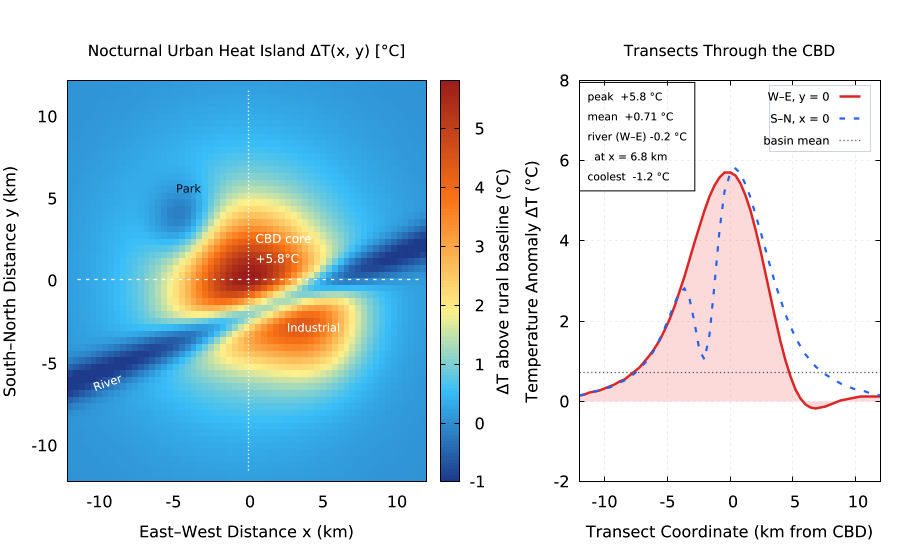 | 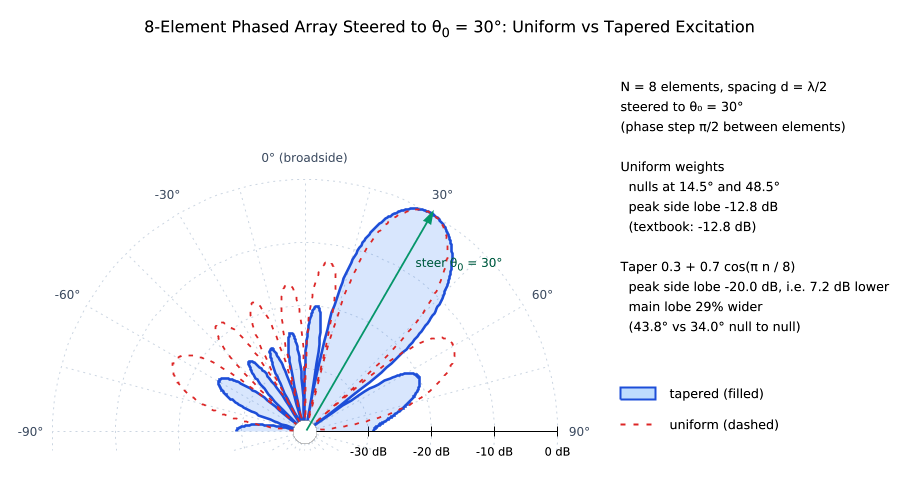 |
| Stellar spectra & bolometric flux<br>`lmctl autorun https://raw.githubusercontent.com/lmctl-ai/lmplot/main/examples/blackbody_planck.lms` | 2D anomaly map & river cooling dip<br>`lmctl autorun https://raw.githubusercontent.com/lmctl-ai/lmplot/main/examples/urban_heat_island.lms` | Measured nulls & −12.8 dB side lobe vs taper<br>`lmctl autorun https://raw.githubusercontent.com/lmctl-ai/lmplot/main/examples/phased_array_polar.lms` |

| Enzyme kinetics & Lineweaver–Burk | Driven damped harmonic resonance | Linear regression & `stats` round-trip |
| --- | --- | --- |
| 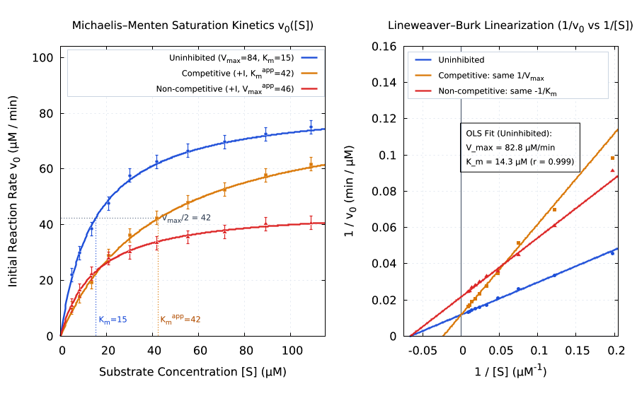 | 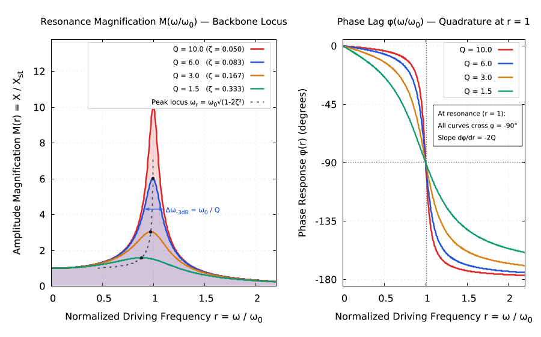 | 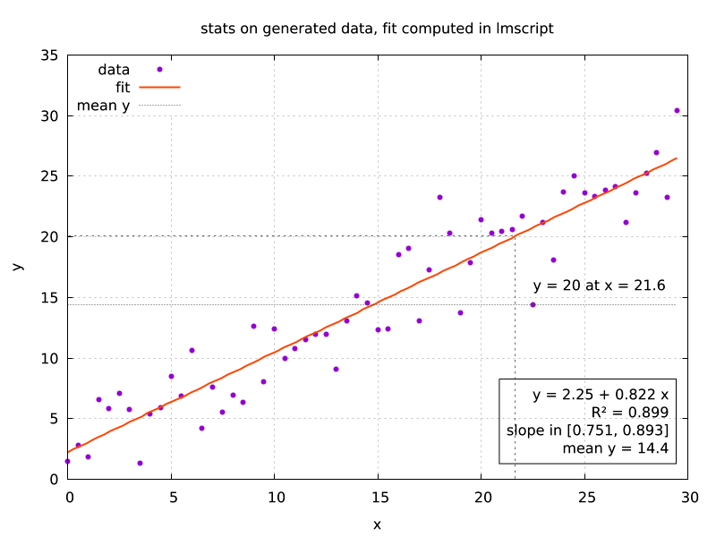 |
| Competitive vs non-competitive OLS<br>`lmctl autorun https://raw.githubusercontent.com/lmctl-ai/lmplot/main/examples/enzyme_michaelis_menten.lms` | Magnification backbone & phase lag<br>`lmctl autorun https://raw.githubusercontent.com/lmctl-ai/lmplot/main/examples/damped_driven_resonance.lms` | LCG data, `stats` & derived labels<br>`lmctl autorun https://raw.githubusercontent.com/lmctl-ai/lmplot/main/examples/stats.lms` |

| Surfaces and colour (`pm3d`) | Filled curves | Clustered & stacked histograms |
| --- | --- | --- |
|  |  |  |
| Radial sinc surface & map projection<br>`lmctl autorun https://raw.githubusercontent.com/lmctl-ai/lmplot/main/examples/pm3d.lms` | Parametric & bounded area fills<br>`lmctl autorun https://raw.githubusercontent.com/lmctl-ai/lmplot/main/examples/fillcrvs.lms` | Clustered, stacked & row-stacked bars<br>`lmctl autorun https://raw.githubusercontent.com/lmctl-ai/lmplot/main/examples/histograms.lms` |

| 3D & base contours | Matrix heat maps | Spider (radar) plots |
| --- | --- | --- |
| 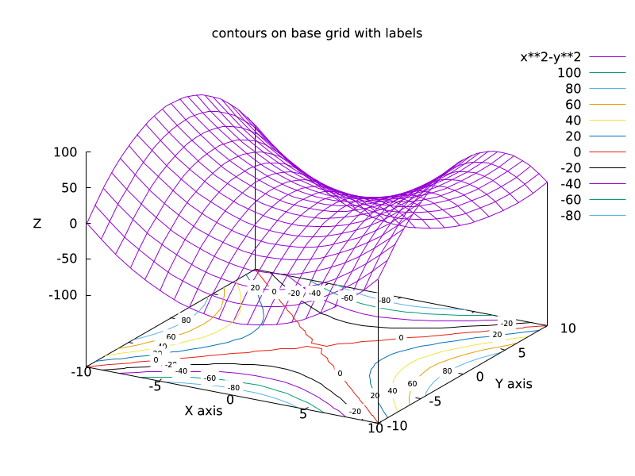 |  |  |
| Surface + base isolines<br>`lmctl autorun https://raw.githubusercontent.com/lmctl-ai/lmplot/main/examples/contours.lms` | Matrix image with cell labels<br>`lmctl autorun https://raw.githubusercontent.com/lmctl-ai/lmplot/main/examples/heatmaps.lms` | Multi-axis radar overlay<br>`lmctl autorun https://raw.githubusercontent.com/lmctl-ai/lmplot/main/examples/spiderplot.lms` |

| Enhanced text & Greek symbols | Transparency & hatch patterns | Polar butterfly curve |
| --- | --- | --- |
|  | 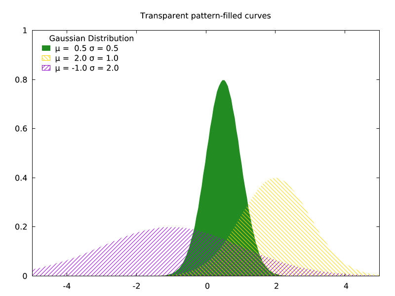 | 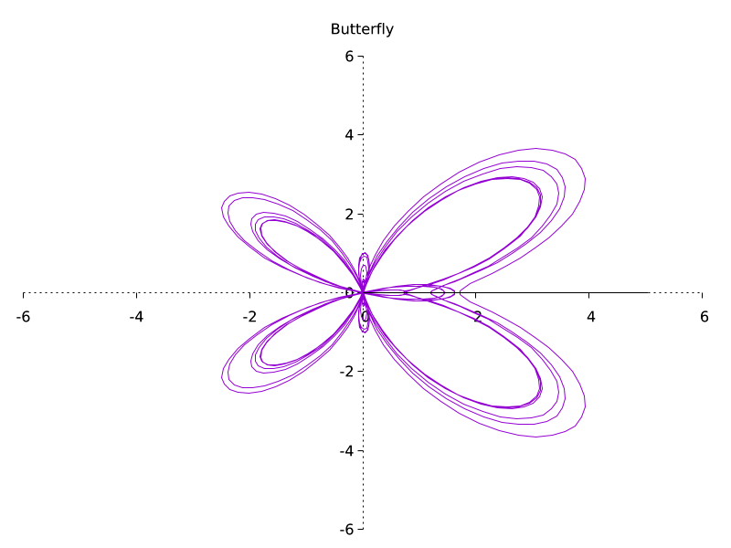 |
| Superscripts, Symbol & UTF-8<br>`lmctl autorun https://raw.githubusercontent.com/lmctl-ai/lmplot/main/examples/enhanced_utf8.lms` | Alpha blending & pattern fills<br>`lmctl autorun https://raw.githubusercontent.com/lmctl-ai/lmplot/main/examples/transparent.lms` | Polar transcendental curve<br>`lmctl autorun https://raw.githubusercontent.com/lmctl-ai/lmplot/main/examples/polar.lms` |

Every image above is produced by a self-contained `.lms` program in `examples/` (runnable from any directory via the `lmctl autorun` command in its caption, writing `images/<name>.png`) and regenerated by `./examples/render-all.sh`. No X11, no Cairo, no libgd, no external fonts: the binary carries its own PNG rasterizer and DejaVu fonts, so `lmplot` runs on a bare container, a CI runner or a laptop with nothing else installed.

## Use it

Download the binary for your platform from the
[releases](https://github.com/lmctl-ai/lmplot/releases) (`lmplot-linux-x64`,
`lmplot-linux-arm64`, `lmplot-macos-arm64`, `lmplot-macos-x64`,
`lmplot-windows-x64.exe`), or build it (below).

**As gnuplot.** `lmplot gnuplot` is the complete gnuplot command line:

```sh
lmplot gnuplot -e 'set terminal png size 800,500; set output "sin.png"; plot sin(x) lw 2'
lmplot gnuplot my_script.gp
```

**From lmscript.** A program is a `_dsl_` block compiled by `lmscript`
(`npm i -g @lmctl-ai/lmctl`). The block names the host, not a schema file:
`lmscript` finds `lmplot` on `PATH`, or downloads the release binary for your
platform on first use (`install=`), and compiles against the schema built into
it:

```
# sine.lms
out = ARGV.len() > 0 ? ARGV[0] : "build/sine.dslb";
mkdir("images");
mkdir("build");
p = _dsl_ cli="lmplot" install="github:lmctl-ai/lmplot@latest";
plot.png("images/sine.png", 800, 500);
plot.cmd("set title 'sin(x) and a fit'");
plot.cmd("plot sin(x) lw 2, x - x**3/6 dt 2");
plot.close();
end _dsl_
savedsl(p, out);
r = system ${dsl_cli(p)} --dsl ${out};   # run it with the binary it was compiled against
assert(r.code == 0);
println("wrote images/sine.png");
```

```sh
lmscript sine.lms     # downloads lmplot on first use if it is not on PATH
lmctl autorun https://raw.githubusercontent.com/lmctl-ai/lmplot/main/examples/kepler_rv_fit.lms
```

The script keeps loops, numbers and string building; gnuplot keeps drawing.
Values come back with `plot.num("STATS_slope")`, so a program can generate
data, run `stats` or `fit`, compute from the results and plot again
(`lmctl autorun https://raw.githubusercontent.com/lmctl-ai/lmplot/main/examples/kepler_rv_fit.lms`
and `lmctl autorun https://raw.githubusercontent.com/lmctl-ai/lmplot/main/examples/stats.lms`),
combine multiple `_dsl_` hosts such as `lmcad` and `lmdraw` in one script
(`lmctl autorun https://raw.githubusercontent.com/lmctl-ai/lmplot/main/examples/combo/nozzle_cad_plot.lms`),
or render a series of frames in a loop
(`lmctl autorun https://raw.githubusercontent.com/lmctl-ai/lmplot/main/examples/turntable.lms`)
and encode them into MP4/GIF animations with `ffmpeg`
(`lmctl autorun https://raw.githubusercontent.com/lmctl-ai/lmplot/main/examples/video/quantum_packet.lms`).

| `plot.` | |
| --- | --- |
| `cmd(s)` / `script(s)` / `load(f)` | run a gnuplot command / several lines / a file |
| `data(name, text)` | define the datablock `$name` |
| `png(f, w, h)` / `svg(f, w, h)` / `close()` | choose the output file and flush it |
| `num(expr)` / `str(expr)` | evaluate a gnuplot expression back into the script |
| `echo(s)` / `terminals()` / `version()` | print, list terminals, version |
| `assert_close(actual, expected, tol)` | stop with exit 3 unless `|actual - expected| <= tol` (known-answer checks) |

A failing gnuplot command stops the program with exit code 3 and a JSON error
line. `lmplot --dry-run --dsl prog.dslb` runs a program without writing any file
(it lists what it would write) and refuses shell commands. Details: [durable-memory/03-schema-v0.md](durable-memory/03-schema-v0.md).

## What is in the box

- **Everything gnuplot does that needs no window system**: 2D/3D plotting,
  pm3d, contours, images, histograms, fitting, `stats`, multiplot, polar,
  spider and parallel-axis plots, watchpoints, voxel grids, the full command
  language and function library. Terminals: `png` (and `pngcairo`), `svg`,
  `canvas`, `postscript`/`eps`, `epslatex`, `pslatex`, `pstricks`, `context`,
  `cgm`, `emf`, `fig`, `hpgl`, `dxf`, `dumb`, `block`, `tek40xx`, ... (run
  `lmplot gnuplot -e "set terminal"`).
- **A native PNG terminal** with anti-aliased lines, alpha, TrueType text in
  any size and angle, enhanced text (`x_1^2`, `{/Symbol a}`) and DejaVu Sans,
  Serif and Mono built in. See
  [durable-memory/04-png-terminal.md](durable-memory/04-png-terminal.md).
- **Images in, too.** `set pixmap` and `binary filetype=png|jpg|gif` read
  images (stb_image instead of libgd), so a render from `lmcad`, `lmdraw` or
  `lmblender` can sit inside an lmplot dashboard.
- **No installation, no runtime files.** Linux builds are fully static; macOS
  links only system libraries; Windows links the MinGW runtime statically.
  `lmplot --notices` prints the licenses of everything inside.
- **Deterministic output.** Rendering the same program twice gives byte-identical
  PNGs (checked for every example).

Not included: interactive windows (X11, Qt, wxt), mouse input, `pause mouse`,
GIF/JPEG output, loading font files.

## Build from source

Needs a C11/C++17 compiler, CMake 3.24 and git. No other libraries.

```sh
scripts/sync-gnuplot.sh        # clone gnuplot at gnuplot.lock, apply patches/
cmake -S . -B build && cmake --build build
./test.sh                      # needs lmscript on PATH for the examples
./examples/render-all.sh       # regenerate all docs/images/* and examples/renders/*
```

Linux gets `-static` (turn off with `-DLMPLOT_FULL_STATIC=OFF`). `./test.sh`
builds, runs the checks (pins, static linking, schema parity, README gallery
links and image magic bytes, 36 standalone examples, byte-identical reruns,
video and multi-host combo pipelines, error paths), and leaves the images in
`build/examples/`.

## Resource limits

A program may use at most 4096 MiB in total (gnuplot's datablocks, arrays and plot data, the png
canvas, everything the host keeps); beyond that it stops with a run error (exit 3) naming the limit,
instead of exhausting the machine. Set `LMPLOT_MAX_MEMORY_MB` to change it, e.g.
`LMPLOT_MAX_MEMORY_MB=16384 lmscript big.lms`; it also applies to `lmplot gnuplot`.

## License

lmplot's own code is [MIT](LICENSE). It embeds gnuplot, which is distributed
under its own permissive license (copyright retained; modified versions are
distributed as patches and marked). The `patches/` directory is that patch
set, it ships with every release, and nothing of gnuplot is committed to this
repository. DejaVu fonts (Bitstream Vera license), stb_truetype and stb_image (MIT)
are also included. The full texts are in [THIRD_PARTY_NOTICES](THIRD_PARTY_NOTICES)
and in the binary (`lmplot --notices`); rationale in
[durable-memory/02-gnuplot-embedding.md](durable-memory/02-gnuplot-embedding.md).

lmplot is a modified version of gnuplot, not the official gnuplot. Report
problems with it at https://github.com/lmctl-ai/lmplot/issues, not to the
gnuplot developers.
