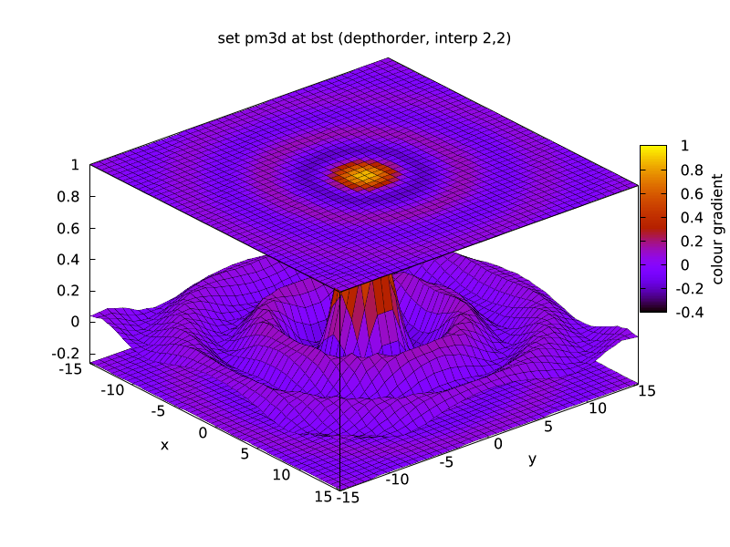
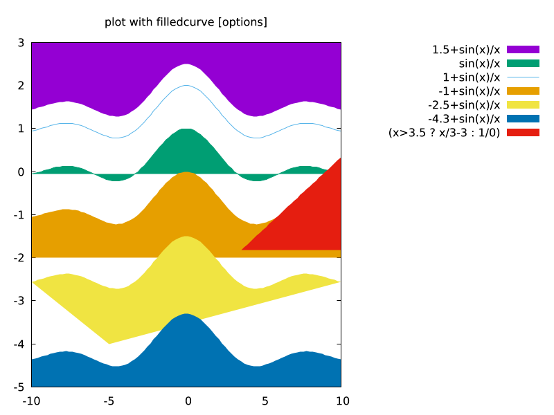
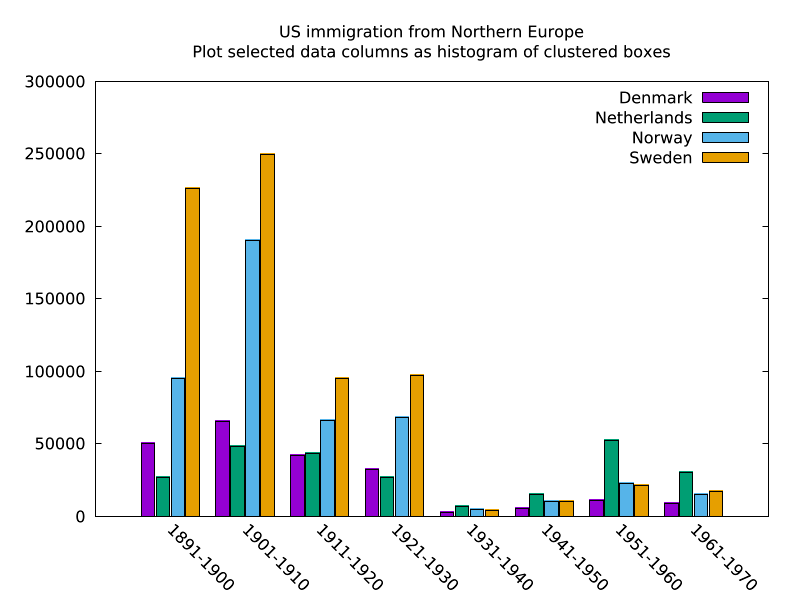
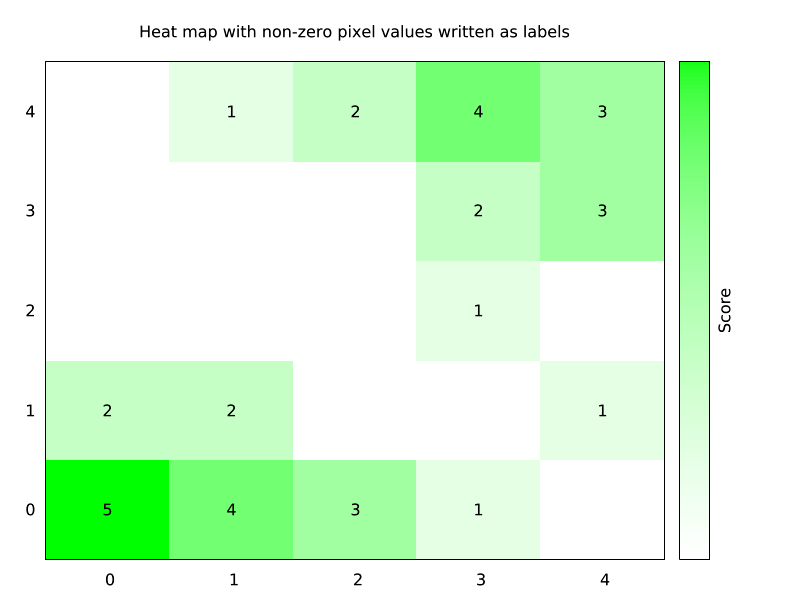
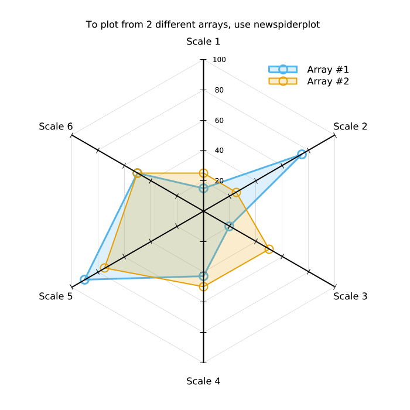
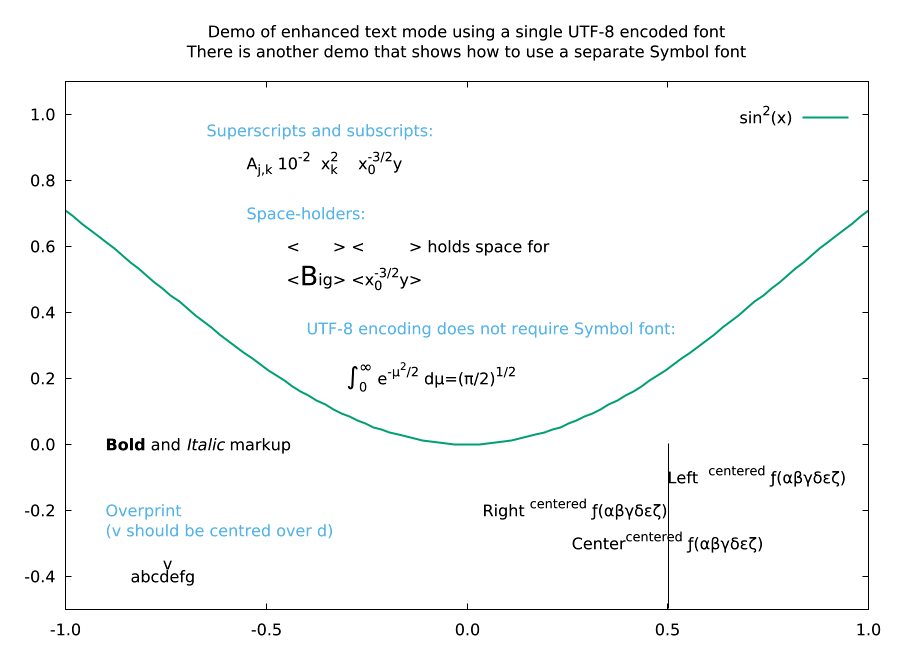

# lmplot

**gnuplot as one static executable, scriptable from lmscript.** No X11, no
Cairo, no libgd, no fonts to install: the binary carries its own PNG renderer
and DejaVu fonts, so `lmplot` runs on a bare container, a CI runner or a
laptop with nothing else installed.

[](https://github.com/lmctl-ai/lmplot/actions/workflows/ci.yml)
[](https://github.com/lmctl-ai/lmplot/releases)
[](LICENSE)

| Surfaces and colour (pm3d) | Filled curves | Histograms |
| --- | --- | --- |
|  |  |  |
| [pm3d.lms](examples/pm3d.lms) | [fillcrvs.lms](examples/fillcrvs.lms) | [histograms.lms](examples/histograms.lms) |

| Contours | Heat maps | Spider plots |
| --- | --- | --- |
|  |  |  |
| [contours.lms](examples/contours.lms) | [heatmaps.lms](examples/heatmaps.lms) | [spiderplot.lms](examples/spiderplot.lms) |

| Data, fit and label computed in lmscript | Enhanced text | Transparency and patterns |
| --- | --- | --- |
|  |  |  |
| [stats.lms](examples/stats.lms) | [enhanced_utf8.lms](examples/enhanced_utf8.lms) | [transparent.lms](examples/transparent.lms) |

All images are written by the programs in [examples/](examples/), which are
lmscript versions of demos from the [gnuplot demo
gallery](https://www.gnuplot.info/screenshots/index.html#demos).

## Use it

Download the binary for your platform from the
[releases](https://github.com/lmctl-ai/lmplot/releases) (`lmplot-linux-x64`,
`lmplot-linux-arm64`, `lmplot-macos-arm64`, `lmplot-macos-x64`,
`lmplot-windows-x64.exe`), or build it (below).

**As gnuplot.** `lmplot gnuplot` is the complete gnuplot command line:

```sh
lmplot gnuplot -e 'set terminal png size 800,500; set output "sin.png"; plot sin(x) lw 2'
lmplot gnuplot my_script.gp
```

**From lmscript.** A program is a `_dsl_` block compiled by `lmscript`
(`npm i -g @lmctl-ai/lmctl`). The block names the host, not a schema file:
`lmscript` finds `lmplot` on `PATH`, or downloads the release binary for your
platform on first use (`install=`), and compiles against the schema built into
it:

```
# sine.lms
p = _dsl_ cli="lmplot" install="github:lmctl-ai/lmplot@latest";
plot.png("sine.png", 800, 500);
plot.cmd("set title 'sin(x) and a fit'");
plot.cmd("plot sin(x) lw 2, x - x**3/6 dt 2");
plot.close();
end _dsl_
savedsl(p, "sine.dslb");
system ${dsl_cli(p)} --dsl sine.dslb;   # run it with exactly the binary it was compiled against
```

```sh
lmscript sine.lms     # downloads lmplot on first use if it is not on PATH
```

The script keeps loops, numbers and string building; gnuplot keeps drawing.
Values come back with `plot.num("STATS_slope")`, so a program can generate
data, run `stats` or `fit`, compute from the results and plot again (see
[stats.lms](examples/stats.lms)), or render a series of frames in a loop (see
[turntable.lms](examples/turntable.lms)) and turn them into video with ffmpeg
(see [examples/video](examples/video/): `lmscript examples/video/wave.lms`).

| `plot.` | |
| --- | --- |
| `cmd(s)` / `script(s)` / `load(f)` | run a gnuplot command / several lines / a file |
| `data(name, text)` | define the datablock `$name` |
| `png(f, w, h)` / `svg(f, w, h)` / `close()` | choose the output file and flush it |
| `num(expr)` / `str(expr)` | evaluate a gnuplot expression back into the script |
| `echo(s)` / `terminals()` / `version()` | print, list terminals, version |

A failing gnuplot command stops the program with exit code 3 and a JSON error
line. Details: [durable-memory/03-schema-v0.md](durable-memory/03-schema-v0.md).

## What is in the box

- **Everything gnuplot does that needs no window system**: 2D/3D plotting,
  pm3d, contours, images, histograms, fitting, `stats`, multiplot, polar,
  spider and parallel-axis plots, watchpoints, voxel grids, the full command
  language and function library. Terminals: `png` (and `pngcairo`), `svg`,
  `canvas`, `postscript`/`eps`, `epslatex`, `pslatex`, `pstricks`, `context`,
  `cgm`, `emf`, `fig`, `hpgl`, `dxf`, `dumb`, `block`, `tek40xx`, ... (run
  `lmplot gnuplot -e "set terminal"`).
- **A native PNG terminal** with anti-aliased lines, alpha, TrueType text in
  any size and angle, enhanced text (`x_1^2`, `{/Symbol a}`) and DejaVu Sans,
  Serif and Mono built in. See
  [durable-memory/04-png-terminal.md](durable-memory/04-png-terminal.md).
- **No installation, no runtime files.** Linux builds are fully static; macOS
  links only system libraries; Windows links the MinGW runtime statically.
  `lmplot --notices` prints the licenses of everything inside.
- **Deterministic output.** Rendering the same program twice gives byte-identical
  PNGs (checked for every example).

Not included: interactive windows (X11, Qt, wxt), mouse input, `pause mouse`,
GIF/JPEG output, loading font files.

## Build from source

Needs a C11/C++17 compiler, CMake 3.24 and git. No other libraries.

```sh
scripts/sync-gnuplot.sh        # clone gnuplot at gnuplot.lock, apply patches/
cmake -S . -B build && cmake --build build
./test.sh                      # needs lmscript on PATH for the examples
```

Linux gets `-static` (turn off with `-DLMPLOT_FULL_STATIC=OFF`). `./test.sh`
builds, runs the checks (pins, static linking, schema parity, 28 examples,
byte-identical reruns, error paths), and leaves the images in `build/examples/`.

## License

lmplot's own code is [MIT](LICENSE). It embeds gnuplot, which is distributed
under its own permissive license (copyright retained; modified versions are
distributed as patches and marked). The `patches/` directory is that patch
set, it ships with every release, and nothing of gnuplot is committed to this
repository. DejaVu fonts (Bitstream Vera license) and stb_truetype (MIT) are
also included. The full texts are in [THIRD_PARTY_NOTICES](THIRD_PARTY_NOTICES)
and in the binary (`lmplot --notices`); rationale in
[durable-memory/02-gnuplot-embedding.md](durable-memory/02-gnuplot-embedding.md).

lmplot is a modified version of gnuplot, not the official gnuplot. Report
problems with it at https://github.com/lmctl-ai/lmplot/issues, not to the
gnuplot developers.
